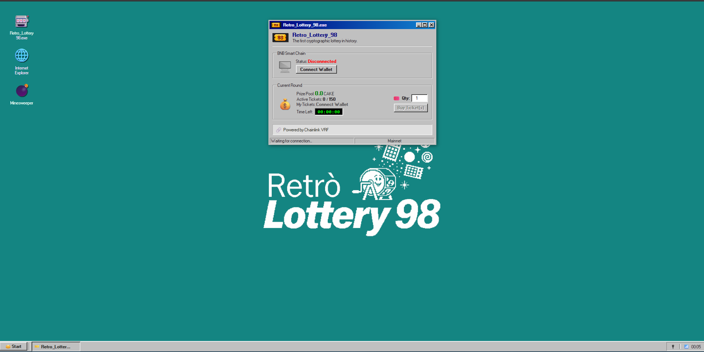

# Retro Lottery 98

A non-custodial, verifiable **CAKE** lottery and retro Web3 arcade on **BNB Smart Chain Mainnet**, wrapped in a lightweight **Windows 98 desktop interface**.

**Live dApp:** [https://retrolottery98.com](https://retrolottery98.com)

## Overview

**Retro Lottery 98** strips away heavy DeFi dashboards and centralized trust assumptions. The portal runs on **Cloudflare Workers with Static Assets** and communicates directly with a verified Solidity smart contract—no user accounts, no KYC, no centralized deposits, and exact-amount ERC-20 token approvals only.

## Core Architecture

* **Non-Custodial by Design:** Players connect any standard Web3 wallet and interact directly with the smart contract on BNB Smart Chain. Funds stay locked in the contract until automatic payout or refund.
* **Exact-Amount Token Approvals:** Both ticket purchases and swaps strictly enforce exact-amount BEP-20 approvals (no unlimited `MaxUint256` spending caps).
* **Provably Fair Randomness (Chainlink VRF v2.5):** Winner selection is computed cryptographically on-chain via **Chainlink VRF v2.5** (funded with native BNB). Each ticket can only win once per round, and draws cannot be predicted or manipulated.
* **Instant 150-Ticket Quorum or Permissionless 24h Draw:** Each round lasts **24 hours** or up to **150 tickets**, whichever comes first. At 150 tickets, the Chainlink VRF draw triggers automatically. If the 24h timer expires with at least **5 tickets**, the **Draw Winners (24h)** button unlocks for any participant so the lottery never depends on a central operator.
* **Anti-Lock Auto-Refund (< 5 Tickets):** If only 1 to 4 tickets are sold when the 24h timer expires, the **Claim Refund** button unlocks for everyone, returning **100% of the CAKE** to buyers with **0% fee**.

## Protocol Economics & Parameters

| Parameter | Value |
| :--- | :--- |
| **Network** | BNB Smart Chain (BSC Mainnet) |
| **Ticket Currency & Price** | 1 CAKE per ticket (BEP-20) |
| **Round Cap & Duration** | Max 150 tickets or 24 hours (whichever comes first) |
| **Total Winners (Full Round)** | **28 winners** (no duplicate winning tickets) |
| **Net Prize Pool Payout** | **95%** sent automatically on-chain to winning wallets |
| **Protocol Fee** | **5%** flat (covers maintenance & Chainlink VRF v2.5 costs) |
| **Minimum Threshold** | 5 tickets per round (100% fee-free refund if 1–4 tickets) |

### 28-Winner Prize Breakdown (on 150 tickets — 142.50 CAKE Net Pool)

* **1st Prize:** 50% of Podium Pool (**58.75 CAKE**)
* **2nd Prize:** 30% of Podium Pool (**35.25 CAKE**)
* **3rd Prize:** 20% of Podium Pool (**23.50 CAKE**)
* **4th to 28th Place (25 winners):** **1.00 CAKE** each (100% ticket cost recovery, scaled proportionally if fewer than 150 tickets are sold)

## Built-In Tools & Free Retro Arcade

* **`Retro_Swap_98.exe` (0% Platform Fee):** Direct BEP-20 / BNB swaps via the official **PancakeSwap V3 Smart Router** with zero added platform fees.
* **`Crypto_Sweeper_98.exe` & `Crypto_Solitaire_98.exe`:** Free-to-play Windows 98 crypto arcade games (Beginner, Intermediate, Expert modes for Sweeper; classic Klondike for Solitaire).
* **Zero-Gas Top 10 Leaderboard:** Off-chain arcade high-score leaderboard backed by Cloudflare KV (lottery state and funds remain 100% on-chain).

## On-Chain Verification

* **Live dApp:** [https://retrolottery98.com](https://retrolottery98.com)
* **Smart Contract (BSC Mainnet):** `0xCec1F2845C979D19d1fD9cAf06C6BDC58D8EE57B`
* **Verified Source on BscScan:** [View Contract on BscScan](https://bscscan.com/address/0xCec1F2845C979D19d1fD9cAf06C6BDC58D8EE57B#code)
* **Contract File in this Repo:** [`contracts/RetroLottery98.sol`](./contracts/RetroLottery98.sol)

## Technical Write-Ups

* **DEV.to:** [Architecture Breakdown on DEV.to](https://dev.to/john_titor_1991/i-built-a-non-custodial-cake-lottery-with-a-windows-98-ui-and-chainlink-vrf-v25-2ogl)
* **Hashnode:** [Architecture Breakdown on Hashnode](https://retrolottery98.hashnode.dev/)
* **Paragraph:** *(https://paragraph.com/@retrolottery98/preview/EVoCMrt43dYmOT6zsv2e)*

## Disclaimer

Retro Lottery 98 is an independent, experimental Web3 project provided as-is. Always inspect the verified smart contract on BscScan before interacting and ensure compliance with your local regulations.
